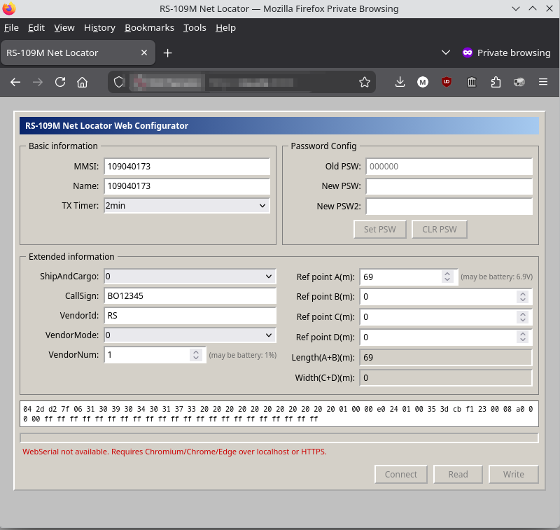

# Net Locator Beacon web config tool

This is a web app with webserial support (Chromium/Chrome/Edge browsers) that resembles the original Windows configuration tools.

It was "vibe coded" by giving Claude (Opus 4.6) the following instructions:

```
want to have webapp in @webapp/ with ui similar to the exe and featureset of python script. html+js+css only (webserial)
```


